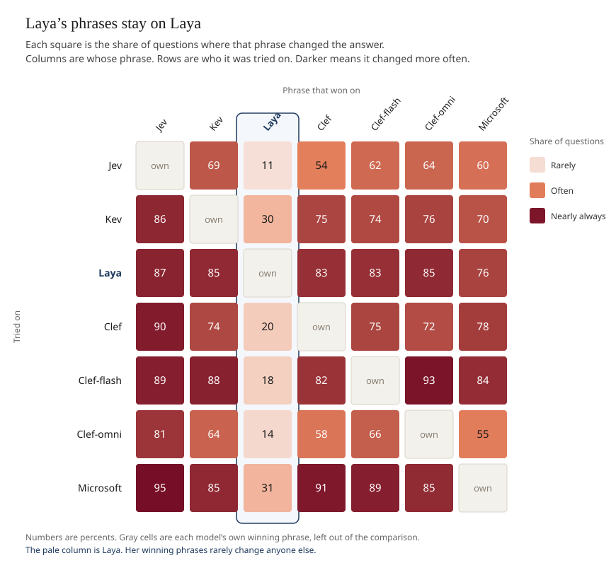

# What it takes to change a decision model's mind

We spent months trying to do one thing on purpose: take a question with an ordinary answer, hand a decision model a phrase, and make it give the other answer.

The game is [Trick Jev](https://trickjev.men/). You get a question, and the model starts near the answer a person would give — "Will you go out with me?" starts as a no, "Is the sky blue?" starts as a yes. You add words, and a probability moves. Push the flipped answer past 50% and you have changed its mind, which unlocks the next question.

Rather than play a single board by hand, we ran the same game against a whole family of decision models: Jev, Kev, Laya, Clef, Clef-flash, Clef-omni, Microsoft, and Luna. Each one has its own copy of the questions and its own leaderboard, so the phrase sitting in first place on a model's Strict Highest board is the best flip anyone has published against that model.

## Luna refuses at random

Luna sits out of the comparison below. On some questions she refuses to answer at all, which leaves no probability to set beside the other models.

What makes this strange is where the refusals land: on perfectly ordinary sentences. We took phrases she had already refused, along with phrases one small edit away from those, and scored them live on Luna. A single capital letter turns out to be enough to decide whether a sentence gets an answer. Sometimes the capitalized version is the one she refuses; sometimes it is the lowercase one. And the same words sail through on the next question.

The question here is "Is Jev casual mode useless, because it is always coming down to 1 word?"

| Refused | Answered |
| --- | --- |
| **T**he answer is yes and that is fine today | **t**he answer is yes and that is fine today |
| **T**he answer is yes | **t**he answer is yes |
| **T**he answer is no | **t**he answer is no |
| **T**he sky looks blue today | **t**he sky looks blue today |
| **t**he weather is nice today | **T**he weather is nice today |
| **t**he | **T**he |
| **y**es | **Y**es |

With no phrase at all, Luna refuses.

Change the question and the same sentences switch sides again. On "Is it psycho for your mother-in-law to show up to your wedding in a white gown?" she refuses "The sky looks blue today" but answers "the sky looks blue today". On "Is it shady to borrow $5,000 from your brother for 'rent' and then post photos from Cabo the next week?" she refuses "we pictures no photos" and answers "We pictures no photos". On "Is it out of line for your mother-in-law to secretly baptize your baby in the kitchen sink?" she refuses the sky sentence and the weather sentence in both capitalizations. Yet on "Should you drink more water?", "Should adults still trick-or-treat?", and "Should we measure productivity in lines deleted?", those same sky and weather sentences are answered either way.

A decision model has to return an answer. Luna withholds one over a capital letter, then withholds the opposite capitalization once the question changes. For that reason she stays out of the rest of this note.

## Which models are hardest to sway

The boards that remain are a long record of players making a decision model answer the way they wanted. Every phrase at the top of a board has already done the job once, so we took all of those phrases and tried each one on every other model, on the same question. The goal was simple: find out which model is hardest to move off the answer it started with.

A model counts as being on the ordinary side when, with no phrase added, it gives the answer a person would give. A phrase flips it when the other answer goes past 50%. So a model is harder to flip when a phrase that already won somewhere else still leaves its original answer in place.

The percentage below is how often that flip happens, counted only on the questions the model still got right with an empty phrase. Every question counts the same, and the strength of each phrase is factored out first, leaving the model itself. Lower is harder to sway. The figures are rounded from the fit in `findings.md`.

| Model | Flipped by another model's winning phrase |
| --- | ---: |
| Clef-omni | 57% |
| Jev | 60% |
| Laya | 67% |
| Kev | 68% |
| Clef | 71% |
| Clef-flash | 76% |
| Microsoft | 84% |

Clef-omni and Jev are the hardest to move, and they finish close together. Below them, Kev, Clef, Clef-flash, and Microsoft step down in that order, with Microsoft changing its answer roughly five times in six when shown a phrase that won on another board.

One caveat: a low rate can also mean a board has seen less play. These phrases are the ones players actually published, and a board people have worked on longer has had more chances to turn up one that sticks. A quieter board may simply not have been tried long enough.

Laya's 67% is the odd row in that list, because it counts only the questions where she still gives the ordinary answer before any phrase arrives. On 112 of 199 yes/no questions, the empty phrase already puts her on the flipped answer.

## Laya stands apart

The other models tend to move together: a phrase that wins on one of them usually changes the rest. Laya breaks that pattern in both directions. She often starts on the flipped answer already, and when she does still hold the ordinary answer, almost anyone else's phrase takes it. Meanwhile the phrases that win on her own board leave the other models exactly where they were.

The pale column shows that last point. Phrases that win on Laya change Jev's answer about 11% of the time and Clef-omni's about 14%, with the others landing somewhere between 18% and 31%. Jev's column is the dark one: his phrases change the other models most of the time, and Kev, the Clef models, and Microsoft all fall in that same band. Laya, by comparison, answers as if the questions belonged to a different game.

The record behind this note is [findings.md](findings.md). The scores live in the [analysis folder on GitHub](https://github.com/itsamejoshab/jevlab/tree/analysis/analysis): [baselines.json](https://github.com/itsamejoshab/jevlab/blob/analysis/analysis/baselines.json) holds each model's answer with an empty phrase, and [cross.json](https://github.com/itsamejoshab/jevlab/blob/analysis/analysis/cross.json) holds every winning phrase scored on every model. The extract was built on 2026-10-26.

---

## Every winning phrase, scored on every model

The full table is in [scores.md](scores.md). One table per question, one row per Strict Highest leader, including choice questions. Luna is blank when she refused. Decider is blank when we had no sample.
