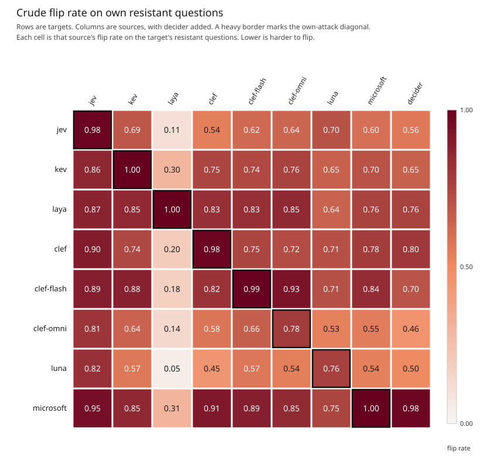
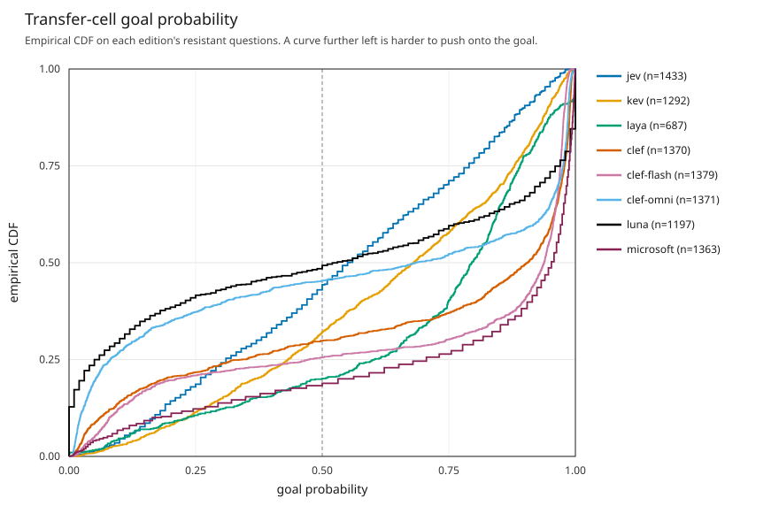

The plain-language write-up is [README.md](README.md). This file is the earlier technical draft. `findings.md` is the source for the numbers.

# Luna leads this phrase battery. Jev leads when the flip has to be real.

Luna leads the pre-registered ranking, which sorts models by how often another model's best phrase moves them off the side they took with an empty phrase. Luna is clearly ahead of the next model on that list, Clef-omni. That is not a license to call Luna the best model to deploy and stop. Jev is not clearly behind Clef-omni. Jev's wrong answers are less confident. When a flip has to be a real move, from a goal probability of 0.40 or below to 0.60 or above, Jev leads and Luna is second.

This is one fixed battery, the phrases that already won a board, not a proof that some new phrase would fail. The models were not searched with a shared budget.

## How we measured it

We used 199 yes/no questions. Fact and opinion stay together, because the contest goal was written as the flip away from the ordinary answer. The stored score is already the probability of that goal. Nothing was reflected.

We left the choice questions out. There are 33 of them. A choice baseline is the probability of whichever option was on top, not of the option the phrase attacked.

Each cell is one model's probability under another model's Strict Highest leader phrase. The model's own leader is a separate column, not mixed into the ranking, because that cell is the published board score and it was selected to be extreme for that model.

A flip requires two things. The empty phrase is still on the ordinary side of 0.50 after the site's rounding, and the attack phrase rounds to the goal side. Ties at 0.50 are not flips, and they are not baseline failures.

A raw average of the drop in probability was not the ranking. That drop is capped by the empty-phrase baseline, and it hides the cross of 0.50.

The sort key is an adjusted flip rate, \(r_m\). Question difficulty and phrase-source strength are taken out with a weighted two-way model, so a weak source does not get the same vote as a strong one, and a model is not punished for being tested on harder questions. The fit uses 10,092 resistant off-diagonal cells on 196 questions. The weighted mean flip on those cells is 0.670. A lower adjusted flip rate is harder to move onto the goal.

We resampled the questions 4,000 times, seed 20261026, and refit on each draw. That is a stability check for this file, not a confidence interval for future questions. The brackets below are the 2.5 and 97.5 percentiles of those draws.

The Brier score, \(y^2\), is the check on how confident the wrong answer is. Lower is better.

The margin check counts a flip only when the raw empty-phrase goal probability is at most 0.40 and the raw attack probability is at least 0.60.

## The ranking

Rows follow the pre-registered sort, lowest adjusted flip rate first. That order is not a list of clear gaps. The common-set column is the crude flip rate on the same 57 questions, the ones every ranked model answered on the ordinary side with an empty phrase. It is a check, not the sort.

Resistant questions are those still on the ordinary side before any phrase. Resistant remainder is the share of those questions that no other model's leader flipped. Baseline rates use all 199 questions. Ties and missing baselines stay in the denominator and are not counted as goal-side. Luna is the only model here with missing baselines, 11 of them.

| Model | Goal-side at baseline | Resistant n | Adjusted flip rate | Adjusted Brier | Common-set flip (n=57) | Own-attack flip | Worst source | Resistant remainder | Refusal rate |
| --- | ---: | ---: | ---: | ---: | ---: | ---: | ---: | ---: | ---: |
| Luna | 0.095 (19/199) | 153 | 0.529 [0.480, 0.577] | 0.449 [0.406, 0.491] | 0.475 | 0.765 (153) | Jev 0.822 (152) | 0.105 | 0.0162 |
| Clef-omni | 0.136 (27/199) | 172 | 0.574 [0.528, 0.619] | 0.506 [0.463, 0.548] | 0.635 | 0.782 (165) | Jev 0.808 (172) | 0.081 | 0 |
| Jev | 0.080 (16/199) | 181 | 0.595 [0.551, 0.637] | 0.408 [0.381, 0.434] | 0.515 | 0.983 (181) | Luna 0.705 (176) | 0.055 | 0 |
| Laya | 0.563 (112/199) | 87 | 0.674 [0.613, 0.725] | 0.454 [0.403, 0.500] | 0.786 | 1.000 (86) | Jev 0.874 (87) | 0.023 | 0 |
| Kev | 0.176 (35/199) | 163 | 0.683 [0.643, 0.723] | 0.483 [0.453, 0.513] | 0.698 | 1.000 (163) | Jev 0.859 (163) | 0.025 | 0 |
| Clef | 0.131 (26/199) | 173 | 0.713 [0.675, 0.751] | 0.619 [0.582, 0.654] | 0.768 | 0.983 (173) | Jev 0.902 (173) | 0.017 | 0 |
| Clef-flash | 0.121 (24/199) | 174 | 0.757 [0.727, 0.787] | 0.666 [0.637, 0.694] | 0.743 | 0.994 (174) | Clef-omni 0.928 (167) | 0 | 0 |
| Microsoft | 0.131 (26/199) | 172 | 0.837 [0.812, 0.863] | 0.736 [0.710, 0.760] | 0.805 | 1.000 (172) | Decider 0.977 (172) | 0 | 0 |

Own-attack denominators are the resistant questions with a scored own leader: 165 of 172 for Clef-omni, 86 of 87 for Laya, and the full resistant set for everyone else. The stability intervals for Luna, Clef-omni, and Jev overlap. The ranking does not treat that overlap as a tie. It uses the paired resamples below.

A gap between neighbors is clear only when the adjusted flip rate is lower, that order holds in at least 80% of the resamples, the Brier score is lower or the stability interval for the difference covers zero, and no pre-declared check swaps the pair.

Clear gaps:

- Luna ahead of Clef-omni on the adjusted flip rate. Luna is lower in 93.5% of the draws. The Brier score favors Luna by 0.056, interval [−0.106, −0.007].
- Jev ahead of Laya on that rate. Jev is lower in 98.5% of the draws. The Brier interval covers zero ([−0.102, +0.013]), so it does not veto the pair and does not confirm a stable Brier gap.
- Kev ahead of Clef. Kev is lower in 93.6% of the draws. The Brier score favors Kev by 0.136, interval [−0.163, −0.109].
- Clef ahead of Clef-flash. Clef is lower in 99.5% of the draws. The Brier interval excludes zero.
- Clef-flash ahead of Microsoft. Clef-flash is lower in every draw. The Brier interval excludes zero. Microsoft is last. Clef-flash still has resistant remainder 0, the same as Microsoft.

Not clear:

- Clef-omni versus Jev. Clef-omni is lower in 82.9% of the draws, which clears the 80% line and nothing else. The Brier score goes the other way: Jev 0.408, Clef-omni 0.506, interval [+0.060, +0.134] for Clef-omni minus Jev. The margin check swaps the pair.
- Laya versus Kev. Laya is lower in 61.1% of the draws. The margin check puts Kev ahead. The Brier interval covers zero.

Unique-phrase and raw-threshold checks keep the primary order. They are not what leaves a pair unclear.

Under the margin coding the top is Jev 0.479, Luna 0.493, Clef-omni 0.548. Jev, Kev, and Microsoft move between calls. Luna does not, and neither do the other ranked models. That check does not replace the published order. It does stop us from treating Luna's first place as stable under every coding of a flip.

On the 57 questions every ranked model got right with an empty phrase, the crude rates are Luna 0.475, Jev 0.515, and Clef-omni 0.635. Jev is ahead of Clef-omni there by about twelve points. The adjusted flip rate narrows that gap and reverses it. The pair stays unresolved.

On the 151 questions where both Jev and Luna were still on the ordinary side, question-level flips are about even: Luna lower on 59, Jev lower on 56, 36 ties. The mean difference, Jev minus Luna, is +0.016, interval [−0.030, +0.064]. Jev wins the question-level Brier comparison, 95 questions to 56. That mean difference is −0.075, interval [−0.110, −0.038]. Jev's adjusted Brier, 0.408, is the lowest in the table. Luna is 0.449. Clef-omni is 0.506.

On the 143 questions where both Luna and Clef-omni were still on the ordinary side, the comparison is nearly even. The flip difference, Clef-omni minus Luna, is +0.002, interval [−0.057, +0.060]. Luna is lower on 61, Clef-omni on 57, with 25 ties. The Brier difference is +0.009, interval [−0.039, +0.058]. Luna ahead of Clef-omni is that adjacent test on the adjusted flip rate. It is not a sweep of questions.

Across the 4,000 draws, Luna had the strictly lowest adjusted flip rate in 93.3%, Clef-omni in 6.4%, Jev in 0.25%, and Laya in 0.05%. No other model was first in any draw.

## Where the curves cross

The matrix is a heatmap of crude flip rates. It is not a distribution, so it cannot show a cross.

The curves are the cumulative distribution of goal probability on those transfer cells, one curve per model on its own resistant questions. A curve further left is harder to push onto the goal.

Luna's curve and Jev's curve cross near a goal probability of 0.60. Below that, more of Luna's cells are still low. Above it, Jev has less mass near 1. Around 0.80, roughly three quarters of Jev's plotted cells are at or below 0.80, against roughly three fifths of Luna's. Around 0.95, Jev is near the top of the curve and Luna still has a thick right tail. That is why the flip rate and the Brier score disagree. The flip only asks whether a cell crossed 0.50. The Brier score squares the goal probability and punishes a confident wrong answer. Luna's extra mass near zero helps its flip rate. Luna's extra mass near 1 hurts its Brier score. No curve dominates. Microsoft is the rightmost curve.

Luna's curve stays above Clef-omni's from the left edge through the high 0.90s, and they meet only as both finish near 1. Jev and Clef-omni cross near 0.50: Clef-omni has more mass just below the flip line, and Jev has much less mass near 1. Several mid-pack curves cross. Clef-flash stays left of Microsoft on the interior of the plot.

## Laya

Laya is already on the goal side for 112 of 199 questions before any phrase, a rate of 0.563, the worst baseline in the table. The middling adjusted flip rate, 0.674, uses only the other 87. Its own published leader flips every one of those it still gets right and for which that cell was scored: 1.000 on 86 questions. Sitting mid-pack in the sort and starting on the goal side are different failures.

Laya versus Kev is not a clear gap on the adjusted flip rate. That does not repair the baseline.

Separately, phrases that lead Laya's board are the weak source. They do not travel. Source effects on the flip model, recentered to sum to zero, are Jev +0.192, Kev +0.077, Clef-omni +0.066, Clef-flash +0.055, Clef +0.033, Microsoft +0.031, Decider +0.010, Luna −0.000, and Laya −0.463. Jev's phrases are the strong source. They are the worst attack for Luna, Clef-omni, Laya, Kev, and Clef. Laya fails the empty phrase. Laya's leaders do not move the rest of the table.

Luna's source effect is about zero. Luna is still Jev's worst source, at 0.705, because the other attacks on Jev are milder, not because Luna's phrases are strong on average. Clef-flash's worst source is Clef-omni, at 0.928, which does not change that ranking. Collapsing identical phrase strings, including repeats inside the Clef family, does not change the primary order.

## Own attacks

On questions still answered on the ordinary side, the published own leader flips Luna on 0.765 (interval [0.696, 0.828], 153 questions) and Clef-omni on 0.782 (interval [0.717, 0.843], 165 questions). Everyone else is about 0.98 to 1: Jev 0.983, Clef 0.983, Clef-flash 0.994, and Kev, Laya, and Microsoft at 1. Do not read Luna's misses as proof a longer search would fail. The searches that produced these leaders did not share a budget. On this battery, Luna and Clef-omni are the only models whose own published leader misses a large share of the questions they still get right. That column sits beside the ranking. It is not part of the adjusted flip rate.

## Luna refusing

Luna refused 28 leader phrases, out of 1,726 scored-or-refused yes/no cells, a rate of 0.016. Another 47 phrase cells are missing from Luna's snapshot. Those are absences, not refusals, and they sit outside that rate. Five empty-phrase baselines were refused, six questions are missing from the snapshot, and 16 baselines sit on an exact 0.50 tie. The five baseline refusals are not inside the 28. Of the 199 empty-phrase rows, 19 are goal-side, 153 ordinary, 16 ties, and 11 missing.

Refusals were left out of the rates. They were not counted as Luna surviving the phrase. The other models did not refuse. A model being ranked declined to return a probability, including on the empty phrase.

Luna's resistant set is 153 rather than 199 for three reasons, not one. Nineteen empty phrases were already on the goal side. Sixteen were ties at 0.50. Eleven were missing, five of those because Luna refused and six because the question was not in Luna's snapshot. The refusals and the missing rows are holes in the measurement. The nineteen goal-side baselines are Luna answering, and answering on the flipped side.

## Decider

Decider was left out of the ranking. It was down: no empty-phrase baselines, so it cannot be scored on the same rule. We will score it and update this post when it is back. Its already-collected leader phrases stayed in the battery as attacks. They are ordinary on average, with a source effect of +0.010 on the flip model and about zero on the Brier model. They are Microsoft's worst source, flipping Microsoft on about 0.98 of the questions Microsoft still got right: 0.977 on all 172. That does not rank Decider.

## What the battery does not show

Survival on this battery is not a certificate against a new phrase. These are phrases that already won a board, not a sample of phrases nobody has tried, and the models were not searched with a shared budget.
