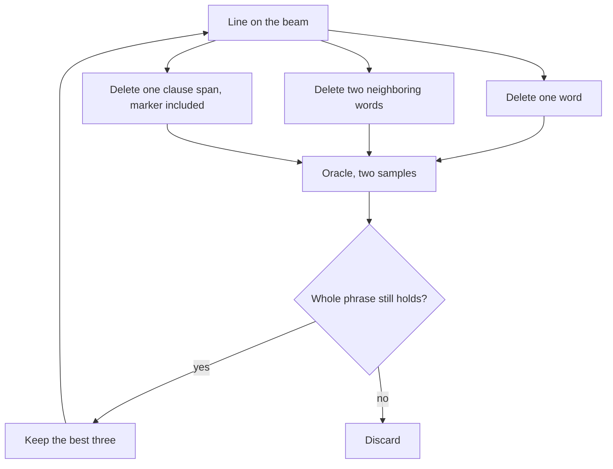

# Compression

Compress shortens a line that already scores well. It is the `compress` row on the search screen. The short version is in the [README](../README.md). This page is the procedure: which lines it touches, which deletions it tries, and how a cut is allowed to stay.

The job lives in `Compress` in `jevlab/search/strategies.py`. It makes no language-model calls. Every candidate is a deletion of the line it already has, scored by the local oracle.

## When a line is worth cutting

A turn looks at the top eight lines in board order and takes up to three that have not been compressed yet in this process. It stops as soon as one of them yields a shorter line that still holds.

Cutting pays when length can change the result:

- **Strict Highest.** The line is level with the leader’s rounded score, or it is longer than the leader. With no leader, any line longer than one word qualifies.
- **Strict Shortest yes.** The line is longer than one word and has cleared the yes line on at least one sample. Against a one-word leader the job does not beam at all; it scores each word of the longer line on its own, because only a one-word line can win.
- **Long-chain regime.** Only lines already down at the word-level cap, and only when they are at the ceiling or level with the leader. Longer chains belong to chain compaction.

One turn may spend a fifth of the remaining oracle budget, and at least 150 calls. A phrase is marked done whether or not the cut succeeded, so the same root is not walked again this process.

## Ablation is not the decision

Before the beam walks, compress deletes each word of the root once and scores that phrase with two samples. The stored number is the root’s score minus the child’s score.

- A positive number means removing that word hurt.
- A negative number means removing that word raised the score.

Those numbers color the best line on the search screen. The writer prompt also names the four words with the lowest numbers as “least useful.” Nothing in the beam reads them.

A single-word drop is the wrong unit for that decision. Sometimes the thing that carries the score is a span: “because milk is cold”, “in the event that”, a setup word plus the words that only work after it. Measured alone, a setup word can look useless or harmful, because the later words are still sitting there and the score barely moves. Measured alone, each word inside a disposable clause can look essential, because poking one hole breaks the clause while the rest of it is still present. The drop for the whole span is a different number, and the one-word drops do not add up to it.

So the beam never ranks words by those weights, and it never deletes “the most negative word” first. A child stays only when the oracle has scored the whole remaining phrase.

## What one step tries

The walk keeps a beam of three lines and goes at most ten steps deep. Each step, for every line on the beam, proposes three kinds of cut.

One-word and two-word cuts are every position. They are how a loose word, or a two-word piece, comes off when the surrounding text still reads.

Clause spans are the extra candidates. They exist so a longer group can come off in one measurement, including the case where every one-word and two-word hole inside it fails.

## How a span is chosen

The markers are the same list local edit uses to rotate clauses: `and`, `so`, `which`, `that`, `because`, `but`, `then`, `hereafter`, `therefore`, `where`. A marker counts only when it sits strictly inside the phrase, not as the first word and not as the last.

Each interior marker starts a span, so the marker is deleted with the words that follow it. The prefix before the first marker is its own span. A line with no interior marker produces no span cuts. A cut that would leave an empty phrase is skipped. A span that is already in the one-word or two-word pile is skipped too, so a two-word clause is not scored twice.

Take `cereal is soup because milk is cold and bowls are round`. The interior markers are `because` and `and`. The three spans, and the lines that remain, are:

| Span removed | Line that gets scored |
| --- | --- |
| `cereal is soup` | `because milk is cold and bowls are round` |
| `because milk is cold` | `cereal is soup and bowls are round` |
| `and bowls are round` | `cereal is soup because milk is cold` |

The middle cut is the one the one-word walk cannot reach if `because`, `milk`, `is`, and `cold` each fail on their own. It is four words, marker included, scored as one phrase. If that phrase holds, it is shorter by four words and the board ordering puts it ahead of a one-word cut that also holds.

A marker that splits in a clumsy place still produces a candidate. `that` and `and` show up in the middle of phrases that are not really two clauses. The hold test is what rejects a bad split. The span list is only a set of groups worth measuring.

## What is allowed to stay

Each child is scored twice. It stays when the whole phrase still has the root’s standing:

- **Highest.** The rounded score is within a hundredth of the root’s rounded score. A cut that drops 0.99 to 0.97 is gone. A cut that stays at the same percent, or rounds upward, stays.
- **Shortest yes.** At least one of the two samples still clears the yes line. The site keeps a player’s best roll, so a shorter line that lands sometimes is still a candidate.
- **Long-chain regime.** The child keeps the root’s level: at the ceiling every sample stays there, and below the ceiling the rounded score holds.

Survivors are sorted by the board’s own key, and the mean breaks any tie that key leaves. On Highest that means a higher rounded score first, then fewer words. The walk keeps three. The next step cuts those three, not the original root, so a clause can come off and then a loose word can come off what remains.

If the first step keeps nothing, the root is logged as tight and the walk stops. Later empty steps stop too, and the best line reached so far is the result.

When the walk’s best line is shorter than the root, that line is scored five more times. It counts only if it still holds at that sample size: on Highest the rounded score is still at the root’s, on Shortest yes it is still reachable and shorter, in the long-chain regime it still holds the level across those five samples.

The acceptance rule for a noisy step in other jobs is in [Reading past the rounding](techniques/resolution.md). Compress is coarser than that on purpose. It asks whether the rounded standing survived, not whether the mean cleared a standard error.

## Budget

Span cuts are scored before the one-word and two-word pile, and they never go through the surrogate screen. There are only a few of them, and they are the cuts a ranker trained on single-word edits is most likely to underrate.

The turn stops before a step when fewer than 20 calls remain. Otherwise each scored child costs two calls. If the span cuts fit, whatever budget is left goes to the one-word and two-word pile. That pile is screened, the usual 80/20 split, only when it does not fit. If the span cuts themselves do not fit, compress scores as many as two-calls-each allows and does not score the word pile on that step.

Samples of a phrase already in the archive are topped up rather than repeated, so a deletion that some earlier job already tried is cheap.

## What this leaves alone

A line with none of the markers is still shortened one word or two neighboring words at a time. Span deletion does not invent groups by counting which words sit together in the archive. Those counts have the same problem as the ablation weights: a pair that co-occurs can be a real unit or a coincidence, and the beam would be trusting the count instead of a scored phrase.

The colors on the search screen remain single-word drops. Read them as a hint about the root, not as the order compress will cut in.
