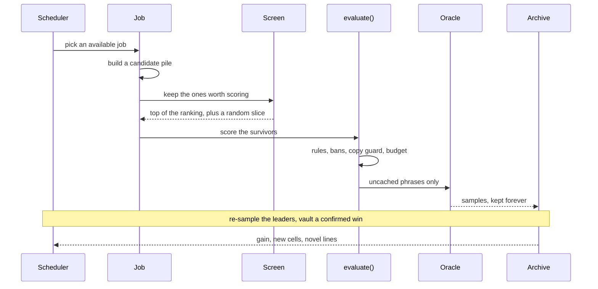
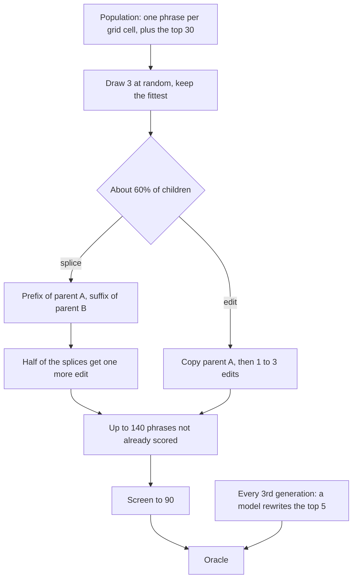
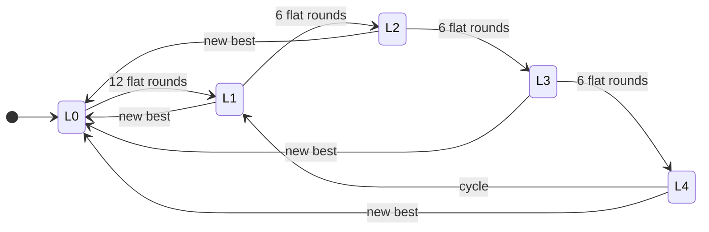

# How a search runs

This is the technical account of the jobs listed in the [README](../README.md). The formulas live on their own pages, linked from the section that uses them, and collected under [The math](#the-math).

A phrase is a Strict chain: Latin letters and digits, no punctuation, each word lowercase, ALL CAPS, or Capitalized, at most 16 characters per word and 60 words per phrase. Choice questions also reject a word that is a fragment of an answer name. `jevlab/rules/strict.py` checks this before anything is scored.

## One round

A round is one pull of the scheduler in `jevlab/search/scheduler.py`. It picks a job. The job writes or edits phrases, a screen cuts the pile down to what the budget can score, and `evaluate()` checks the rules, the ban and pin lists, and the copy guard before the oracle is called. Samples are cached in SQLite, so a phrase is paid for once. The archive stores the phrase, its samples, which job wrote it, and which frame it used. The scheduler is then credited for any gain in the best line, any new region of the archive, and any strong line that does not merely paraphrase the current best.

## Scoring locally

Searching the live site would be slow, public, and rate-limited. `jevlab/oracle.py` sends the request body the site itself sends, with our phrase filled in as the state, to Jev’s scoring endpoint. Calls are pooled across Typesafe and OpenRouter. A calibration replay of site-scored phrases matched the site to within the noise of a single call.

Every sample is kept, keyed by a hash of the request body. Asking for more samples of a leader only tops that phrase up. A later run on the same question restores the whole history. A phrase scores the same on every board, so a Highest run’s history is free data for a Shortest run.

Each backend grows its parallelism when calls succeed and cuts it when they fail. A backend that fails three times in a row rests while the others carry the load. An authentication or billing failure takes that backend out for the process.

The number that comes back is rounded to the nearest hundredth, and the same phrase does not return the same number every time. Repeated samples are how the lab reads past that rounding. The noise model, the test for accepting a step, and the vault’s lower bound are in [Reading past the rounding](techniques/resolution.md).

## What the search is climbing

`jevlab/objective.py` is the only place that defines “better.” On Strict Highest the board orders lines by rounded probability, then fewer words. On Strict Shortest yes a line has to clear the yes line first, and among those lines fewer words win.

That order is flat in the places a search most wants a slope: two lines at 0.98 look identical, and a shorter line never overtakes a higher score. The jobs therefore climb a shaped fitness that agrees with the board order but still moves when the rounded score does not. Highest uses the logit of the probability, with a small length penalty that only starts once a line is about as long as the leader. Shortest yes is a ladder around the yes line: clearing it is worth more than any tie-break, and each word saved is worth more than the tie-break inside a length. The formulas are in [Fitness and board order](techniques/fitness.md).

When the goal answer is “no”, every probability is flipped before either score is computed, so the rest of the lab is always maximizing.

## The archive, and who gets to be a parent

`Archive` (`jevlab/search/archive.py`) holds every phrase scored for the question, with its samples, the job that wrote it, its parent phrase, and its frame. The frame is the rhetorical move that produced it: a renamed subject, a scene, a deduction, a worked example, and the rest of the catalog in `ARCHETYPE_GUIDE`. A line with no frame is filed as `other`.

On top of that list sits a grid keyed by length bucket and frame. Fifteen buckets run from 1 word to 300. Each cell keeps only its fittest phrase. The grid does two jobs. It gives the genetic search and the big edit piles a set of parents that are different shapes of line, rather than thirty paraphrases of one idea. And filling or improving a cell is paid by the scheduler even before it beats the global best.

Two orderings are used on purpose. `top` is shaped fitness, which is what parent selection uses. `top_by_board` is the board’s own key, which is what promotion, compression, and win checks use.

`parents(k)` returns the top `k` by fitness. On a fresh start, half of that set is taken from lines found in the current run, so edits are pushed off the old peak. Against a one-word Shortest yes leader, parents are one-word lines only, because nothing longer can win.

## Who gets the next turn

Every job is an arm. Generator models are one arm per price tier. An arm’s reward for a round is the fitness gained, the new grid cells, and the count of strong lines that are not paraphrases of the current best, divided by how many scores the round spent. The scheduler picks the arm with the best recent average, plus a bonus for arms that have been pulled less, times a fixed prior and whatever boost the planner or the ladder has set. The last eight rounds are all an arm gets to remember, so an early hot streak cannot coast. The formula is in [The bandit](techniques/bandit.md).

The planner is a separate model call that runs when the search stalls. It can bias the scheduler toward writing, editing, or compressing, and it can ban words or hand the writers a directive. It does not score phrases itself.

## Embeddings

Both learned stand-ins start from the same embedder (`jevlab/search/surrogate.py`). The default is `bge-m3` through OpenRouter (`JEV_EMBED_MODEL`). Each text is sent once. The vector is stored in SQLite, keyed by the model id and the text, in a file of its own so the hot database does not carry the blobs. A later training pass reads the cache and only requests texts that have never been embedded. An in-memory cache sits in front of that file and drops old entries once it gets large; a dropped vector is re-read from SQLite, not requested again.

If the OpenRouter embedder cannot start, the lab falls back to fastembed’s `bge-small` on the CPU, which needs `uv sync --extra embed`. If that package is missing too, it falls back to a hashed character n-gram vector: character 3-, 4-, and 5-grams plus whole words, folded into 512 dimensions and normalized. That last path needs no network and no extra install. It is a bag of character features, so it only helps the stand-in when real embeddings are unavailable. `jevlab bench-embed` is how a model gets chosen: holdout rank agreement with scores we already have.

A phrase’s features for the sentence model are that vector with one extra number, the word count divided by 60. The thing being predicted is the logit of the goal probability, not the probability itself, so the top of the range still has room to move. The fit is Bayesian ridge regression. Five-fold cross-validation holds each phrase out once, rank agreement is one Spearman ρ on those out-of-fold predictions, and the ranking model is then refit on everything. The search keeps using the previous model while a new one trains in a background thread. A retrain starts when the archive has grown by a quarter or by 300 phrases, and not before there are 60 phrases. The model is trusted once holdout Spearman ρ reaches 0.2. Bayesian ridge also reports how unsure it is, which is what the upper-confidence ranking needs. The regression, the blend with the cross-question prior, and the acquisition rule are in [Phrase surrogate](techniques/surrogate.md).

A second model, the word surrogate, embeds each word on its own and pools the word vectors two ways: a plain average, and a weighted average that gives later words more weight, plus the same length number. A small one-layer network maps that to the logit. Its ρ is the same pooled 5-fold score, and it is trusted at a stricter 0.3, once there are 80 phrases. Because the pooling is linear in each word vector, the network has a gradient with respect to the word at each position. That gradient is the HotFlip estimate described in [Word surrogate and HotFlip](techniques/hotflip.md).

Before either model exists, yes/no questions can be screened by a cheap chat model that is asked for one token with log probabilities. The lab reads the probability of “yes” from that distribution. `jevlab bench-proxy` ranked `qwen3-235b` as the default. Choice questions and “no”-goal questions skip it. Set `JEV_PROXY_MODEL` empty to turn it off.

There is also one model trained across every question. It sees the text `Q: <title> goal <goal> || <phrase>` and learns an offset from that question’s average logit, so it learns what ranks well inside a question rather than how high that question’s scores sit. A brand-new question is ranked by this prior. As the local model’s holdout ρ climbs, the blend hands control over to it. `jevlab train-global` fits it by hand; a search also retrains it after 500 new phrases have been scored anywhere.

## Screening a pile

Almost every job proposes more phrases than it can afford to score. `screen(pile, k)` is the cut:

1. Drop anything that fails the Strict rules, the length cap, or, in a one-word Shortest race, anything longer than one word.
2. If the phrase surrogate is trusted, rank the survivors by its upper confidence bound.
3. Otherwise, if the logprob proxy is available, rank a sample of the pile by that.
4. Otherwise draw uniformly.

The trusted ranker does not get the whole budget. Eighty percent of the `k` slots are its top picks. The other twenty percent are drawn from what it ranked lower. That slice is what keeps a blind spot in the model from starving the search, and it is also what keeps the next training set from being only the model’s own favorites.

Surrogate-guided search is the exception. It ranks its own pile of 1,500 and sends the top 120, with no random slice, because the uncertainty term in the bound is already its exploration.

## The jobs

### Generators

`LLMGenerate` asks a model to write whole phrases, in the style of an optimizer that proposes candidates in text. The prompt includes the question, the Strict rules, the leader’s score and length (the leader’s text stays hidden), our own scored lines, the best score each frame has reached, the planner’s directive, and frames earlier runs already exhausted.

A normal batch shows three frames. The draw is weighted by the best score each frame has reached, so a frame that is working gets more turns. On a fresh start the weight runs the other way, toward frames that have barely been tried. Once every frame in the batch already has eight scored lines, one slot moves to a frame that does not. The first few Highest batches still reserve one slot for a deduction. Shortest boards do not.

The generator pool is `JEV_GEN_MODELS`, or the default table in `jevlab/config.py`, cheapest first. Tier 0 is in from the start. Tier 1 joins when the ladder reaches the sweep, and tier 2 when it reaches the reframe.

Before the first batch, and again when the current writer has gone stale, every unlocked model writes the same short batch: eight phrases across five frames. Each model’s score is the mean of its best three lines. The highest mean keeps the question. A model within 0.02 of that mean loses to whichever is listed earlier, which is why the cheap models come first. Those probe phrases stay in the archive.

That model then writes every later batch. It is replaced when it has written eight batches and the search has gone six rounds without a better line, or sooner on a question that is already well searched (four batches and four flat rounds once half the frames have eight scored lines). Two empty batches in a row sit the model out and the next batch probes again. Unlocking a higher tier also probes again. The decision is in `jevlab/search/probe.py`.

Rewrites and synonym calls stay on a single cheap model. They are not part of the probe. The next batch is written while the oracle scores the current one.

### Local edit

`LocalEdit` expands one parent into its one-edit neighborhood.

Structural edits are all sent, with no screen: every deletion, every adjacent swap, every move of a word to the front or the back, and every rotation at a clause break. The clause words are `and`, `so`, `which`, `that`, `because`, `but`, `then`, `hereafter`, `therefore`, and `where`.

Lexical edits are screened down to the budget: substitutions from model-suggested synonyms and from the word pool, and insertions at every gap. The word pool, in order, is pinned words, player words with a positive average impact, words from our best lines, and cached synonyms.

Parents are taken by rank and down-weighted by how often they have already been expanded, so one line’s neighborhood is not searched out while others wait.

### Compress

`Compress` shortens a line that is level with the leader, or longer than the leader. Each step of a beam of three tries one-word cuts, two-word cuts, and whole clause spans. A child stays only when the scored phrase still holds the root’s standing. Ablation, the per-word score drop, colors the best line and is not what chooses the cut. The full procedure, including why a single-word weight misleads and how a span is bounded, is in [Compression](compression.md).

### Genetic search

`Genetic` in `jevlab/search/advanced.py` runs once the archive has at least six phrases. One generation looks like this.

**Who is in the population.** The grid’s current cell-holders, plus the top 30 from `parents`. Duplicates collapse. On a one-word Shortest race the population is one-word lines only. On a fresh start, half of the top 30 are lines from this run.

**How a parent is picked.** Tournament of three. Three members are drawn at random and the one with the highest fitness is the parent. Fitness is the shaped score, so on Highest a higher logit wins, and on Shortest yes a shorter qualifying line wins.

**What mating is.** Sixty percent of children have two parents, each chosen by its own tournament. The child is a prefix of the first spliced onto a suffix of the second. Each parent is cut at a clause word when it has one, and at a random word boundary otherwise. The two cut points are chosen independently, so the child can be shorter or longer than either parent. The phrase is filed under the first parent: that parent’s text is the recorded parent, and the child inherits that parent’s frame. The second parent is not recorded.

The other forty percent have one parent. That parent is copied and then edited one, two, or three times, with one edit twice as likely as two or three.

**What an edit is.** One edit is a single change, using a pool of 60 candidate words. While the line is under 60% of the length cap, an insertion is the most likely change, then a replacement, then a deletion, and an adjacent swap is the remainder, so lines can grow. At the cap, insertions stop. A replacement or insertion draws from the same word pool local edit uses.

Half of the spliced children get one such edit after the splice. The rest are the raw splice.

**What is thrown out before a score.** The generator tries up to three attempts per kept child, and stops at 140 kept phrases. A candidate is dropped when it is empty, when that exact phrase is already in the archive, or when this generation already produced it. The archive check is the main prune: children that recreate a scored line never spend a call. After that, `screen` cuts the 140 down to 90, which on a trusted surrogate means the best 72 by upper confidence bound and 18 drawn from the rest.

**The model rewrite.** Every third generation, the cheap writer model is asked to rewrite the current top five parents into a handful of children. Those are added on top of the 90. They are scored, and a win from one of them is counted under the genetic row of the search screen. A failed rewrite is logged and the generation continues with the splices and edits.

### Surrogate-guided search

`SurrogateBO` runs once the phrase surrogate is trusted and the archive has at least ten phrases. It builds a pool of 1,500 phrases from the top 20 parents and the grid. Each candidate starts as one parent and receives one to four edits. One in five is also spliced with a second parent, using the same crossover as the genetic search. Anything already in the archive is dropped.

The whole pool is ranked by the phrase surrogate’s upper confidence bound, with the uncertainty weight set higher than ordinary screening. The top 120 go to the oracle. The other 1,380 are never scored. They exist to give the bound a wide set of hypotheses.

### GCG

`GCGSwap` runs once the word surrogate is trusted. It picks one of the top four parents and, for up to three steps:

1. Asks the word surrogate for the top 16 swaps at each position, over a vocabulary of 400 words. The ranking is the HotFlip estimate in [Word surrogate and HotFlip](techniques/hotflip.md).
2. Builds up to 384 candidates by applying one swap, or two swaps about 30% of the time, drawn from those shortlists.
3. Re-ranks those candidates with the network’s full prediction, and sends the top 48 to the oracle.
4. If any scored child beats the parent on fitness, the step moves to the best of them. If none does, the walk stops.

The same HotFlip ranking orders the vocabulary inside the sweep when the word surrogate is trusted.

### Single word

Strict Shortest yes only. Each round mixes model-suggested single words, all three Strict casings of our best singles, pairs of the best singles, intensifier pairs, the site’s highest-impact player words, and the next slice of an 8,000-word vocabulary through a cursor that persists across runs. Given enough runs, the cursor covers the vocabulary. When the leader is already one word, pairs are left out, and the rest of the search is held to one-word lines too.

### Precision, sweep, boosters, beam

These four are the ladder. They also appear in the job list, and the scheduler can pull them, but the ladder is what gives each one the lead.

#### Precision

Precision is a hill-climb on averaged samples. It samples the roots to eight, sends 48 screened one-edit neighbors at four samples each, races the leading six, and keeps a step only when the gain clears the noise. The acceptance rule is in [Reading past the rounding](techniques/resolution.md). Roots are chosen by a noise-discounted mean, so one lucky sample does not become the place we climb from. On Shortest yes a step is also kept when it improves the board key outright, which a shorter line that still qualifies does.

#### Sweep

Sweep is coordinate ascent. Every slot is tried for substitution and every gap for insertion, against question-specific words first, then every word we have scored, then 20,000 common English words. How many words are tried per position depends on the remaining budget. The best 20 single edits are then combined in pairs. Edits that tie the root’s rounded score are raced. The sweep stops early if a large share of its singles show no hope, and it marks the root as a local optimum when nothing beats it, so that root is not swept again. On Shortest yes it ranks by the board key and skips the tie race, because ties there are decided by length.

#### Boosters

Boosters are short sequences that raise the goal probability across many questions. They are mined from phrases we have already scored, and a separate pass can spend scores to optimise a trigger. The lift formula is in [Booster mining](techniques/boosters.md). A round applies the library to the top five lines as a prefix, a suffix, and at clause breaks. Each booster’s wins and tries are tracked, so a trigger that has worked on this question ranks first. On Shortest yes the prior is lowered, because a booster adds words.

#### Beam

Beam builds from an empty line. A beam of width 16, twenty next-word proposals per prefix from a fast model plus the vocabulary, and every prefix is scored as a phrase. Entering this rung also marks the current top frames as exhausted, so the writers are told to leave them, and parent selection is reset off the old basin.

### Plateau jobs

These run when the board is Highest, the question is yes/no, the leader sits at the observed ceiling with at least 40 words, and earlier runs have already spent a real search on the question (a prior run, or at least 500 restored lines). The length cap rises to one under the leader’s length, up to 300, and the ladder starts at precision. Every third round is reserved for drift and every third for grow, because those two pay off too slowly for the scheduler to learn them. Shortest yes never enters this mode.

#### Grow

Grow appends one word at a time on a beam of width 4, with at most two children per parent. Children that tie on the rounded score are raced. A table records the average score change each appended word caused, shrunk toward zero when a word is rarely seen, and that table feeds the next proposals. The beam and the table are saved, so the next run keeps growing the same lines.

#### Extend

Extend inserts a clause at every clause boundary of the climb root. Clauses come from a cheap model, from fragments of our other strong lines, and from boosters. Insertions that hold the root’s rounded score are raced.

#### Probe climb

Probe climb is for the case where every good line reads the same rounded score, so even an average cannot separate them. It appends a short claim for the other answer. Lines closer to the next level resist that claim more, so the probed values spread out. Edits that hold the level are probed once, the best are probed again, and the walk moves when a step clears the noise. Probe samples are stored apart from the question’s real history.

#### Scenario join

Scenario join asks a writer for scenes in which the wrong answer would be absurd, and joins each scene before and after our best tied lines. The scenes whose joins score best steer the next batch. After two rounds with nothing above the level, the job steps aside.

#### Drift

Drift walks toward the line whose one-word edits most often keep the top score. The score is a smoothed hold rate, in [Reading past the rounding](techniques/resolution.md#hold-rate). The walk’s position is saved.

### Long chains

Off unless `JEV_LONG_TARGET` is set. On the boards where it was tried, it plateaued below the leader. When it is on, the lab builds chains near that word target from fragments of strong lines, boosters, player words, and model fragments, using several recipes (repeat, stack, interleave, a fragment-level genetic join, and others). A ridge fit on which fragments are present attributes the score back to fragments. Ablation drops each fragment of the best chains once and records the loss. Compaction then cuts a chain that holds the ceiling, weakest fragments first, then windows of 32, 16, 8, 4, and 2 words, until the word-level jobs can take over.

At the ceiling every chain reads the same rounded score. The probe pulls the measurement back into a sensitive range by appending a claim for the opposite answer, repeated until reference chains land near 0.7. Chains that resist the claim sit closer to the next level. Those sabotaged pairs are filed under a separate key.

## The ladder

A round that does not produce a new best line counts as flat. After twelve flat rounds at the start, and six on the later rungs, the ladder steps up. Any new best drops it back to ordinary search, because a new basin deserves the cheaper jobs first. The level reached without a win is saved, and the next run on that question resumes there.

| Level | What leads | What else changes |
| --- | --- | --- |
| L0 | The scheduler, over writers and ordinary edits | |
| L1 | Precision climbing | |
| L2 | The coordinate sweep | Mid-tier models join the next probe |
| L3 | Boosters, on yes/no boards | |
| L4 | The beam | Premium models join the next probe, and the top frames are marked exhausted |

## The vault

After every round the top lines are scored again until they have at least five samples. A line is vaulted when its lower confidence bound would beat the public leader under the board’s own key, so a few lucky rolls do not qualify. The bound is in [Reading past the rounding](techniques/resolution.md#the-vault-bound). The leader is read from the last snapshot, with our own rows left out.

On Shortest yes the vault also accepts gambles. The site keeps a player’s best roll, so a line shorter than the leader that cleared the yes line on at least one of five or more samples can still win if it is re-rolled on the site until it lands. It is flagged as a bet, with its hit count, so the publisher knows how many re-rolls to expect.

`jevlab publish` is the step that plays the vaulted line.

### Win mode

In win mode (`--win-after N`), the first vaulted winner caps the run at N more scores.

## Memory and a fresh start

Every run writes a `RunMemory`, keyed by question and board, and by answer for a targeted choice run. It holds the scheduler’s arm state, per-frame bests, phrases already compressed, the synonym cache, the top exhausted frames from runs that did not win, the highest ladder level reached without a win, the plateau beam and drift position, and a short history of how each run ended.

A run on a question that has been tried before, and is not currently winning, is a fresh start. It restores every stored sample, so the surrogates and the archive come back. Half of every parent set comes from this run’s new lines. Writers are told to avoid the exhausted frames, and frames are weighted toward the least tried. Generator arms and the surrogate search get a modest boost. The ladder resumes at the level the last run reached.

Shortest memory is kept separately, so a Shortest run does not resume a Highest run’s level or arm state. The samples themselves are still shared. A Shortest run also seeds itself with every prefix of our top 30 Highest lines. The site scores each prefix of a chain as it is built, so a strong long line often already tips to yes after its first few words.

## Outside the search

### Cross-post

`jevlab/crosspost.py` re-ranks the Strict vault against the Golf and Casual leaders in the snapshot. Golf counts characters and takes the whole phrase in one turn, so every Strict line (either Strict board, any status except dropped) is measured in characters, and the best one per question and board is queued when its lower bound beats the Golf leader. Casual ranks by words the same way Strict Highest does. The publish screen’s casual option takes the Strict Highest answer and queues it on each Casual board that answer would take. A leader already at one or two words wins a tie against a longer line at the same score, so a crowded Casual board usually yields nothing. An empty board is a take. Choice-question lines are matched per answer.

### Import

`vault import-from` (and `import-jev`) copies another edition’s best measured Strict line per board into this edition’s vault as an estimate. The row records which edition it came from. Publish posts a borrowed line without an oracle re-check, and re-checks a line this edition scored itself.

### Defend

`jevlab/defense.py` posts decoy words on boards we already lead. The site’s word list is public, shared by Highest and Shortest inside a play mode, and rivals mine the top of it. Defense posts the question’s own content words, then a few WordNet synonyms of each, then words that have helped on other boards, skipping function words and words already on the list. A board whose headline is long and already mostly other people’s words is left alone. The board keeps every row, so a decoy that takes the lead stays there.

### Target a player

The search setup screen groups boards by the name of the current leader. Choosing a name selects every searchable board that person leads, that we are not already leading, and that is not a one-word perfect score we could only tie.

### Target an answer

`--target` on a choice question sets the score to that option’s probability. Memory, the vault, and cross-posts are filed under the answer, so a run aimed at one option does not mix with a run aimed at another.

### Live mode

`jevlab/live.py` polls the site’s current round and builds a yes/no question from it. The search is the ordinary engine. Fast pace posts an opening word as soon as the round appears and then posts every gain. Slow pace posts only while we are behind. Casual sends the phrase as one turn. Strict sends it one word at a time. A round that names a finish line stops the chain once a turn has crossed it.

## Where the code lives

| Path | Role |
| --- | --- |
| `jevlab/search/engine.py` | The loop, the ladder, promotion, plateau detection |
| `jevlab/search/scheduler.py` | The bandit |
| `jevlab/search/archive.py` | The archive and the length-by-frame grid |
| `jevlab/search/strategies.py` | Generators, local edit, compress, the edit operator |
| `jevlab/search/advanced.py` | Genetic search, surrogate search, GCG |
| `jevlab/search/mechanical.py` | Noise, racing, precision, sweep, beam, plateau jobs |
| `jevlab/search/surrogate.py` | Embeddings, both stand-in models, HotFlip |
| `jevlab/search/global_model.py` | The cross-question prior |
| `jevlab/search/probe.py` | Which generator model keeps the question |
| `jevlab/objective.py` | Board order, fitness, the vault test |
| `jevlab/oracle.py` | The local scorer and the sample cache |
| `jevlab/crosspost.py` | Golf and Casual picks from the Strict vault |
| `jevlab/defense.py` | Decoy words on boards we lead |
| `jevlab/tui/lab.py` | The search screen, including the job list |

## The math

| Page | What it sets down |
| --- | --- |
| [Fitness and board order](techniques/fitness.md) | The two board keys, and the fitness the search climbs |
| [The bandit](techniques/bandit.md) | A round’s reward, and how the next job is chosen |
| [Phrase surrogate](techniques/surrogate.md) | The embedding features, the ridge fit, the confidence bound, the prior blend |
| [Word surrogate and HotFlip](techniques/hotflip.md) | The per-word gradient and the swap estimate |
| [Reading past the rounding](techniques/resolution.md) | The noise table, when a step is kept, the vault bound, the hold rate |
| [Booster mining](techniques/boosters.md) | How a short sequence gets its lift |
